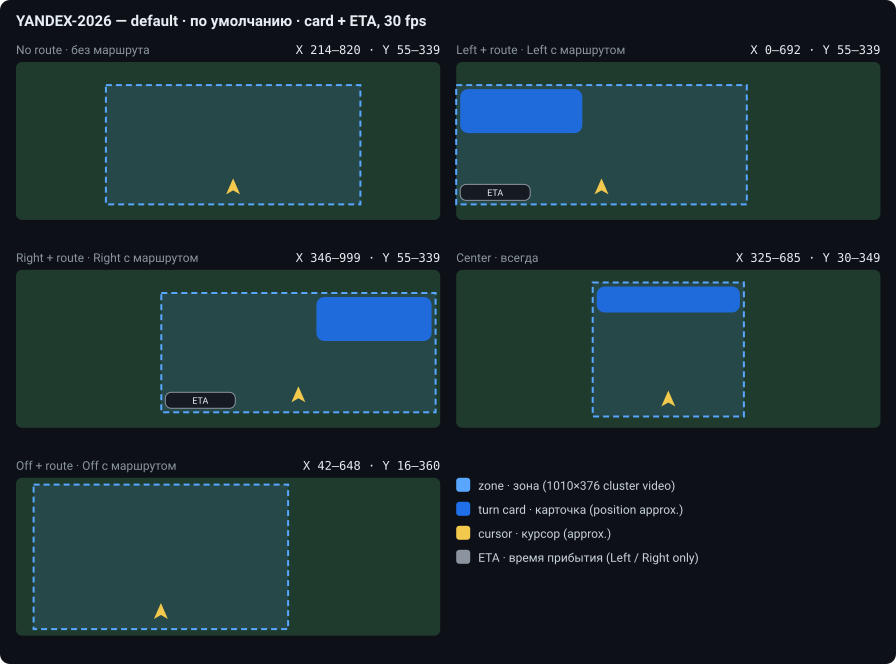
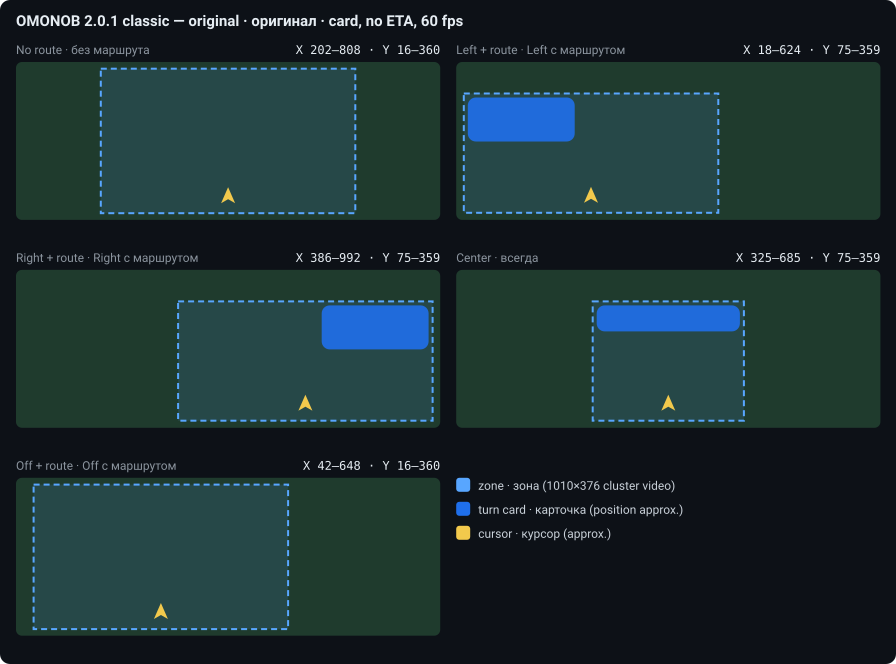
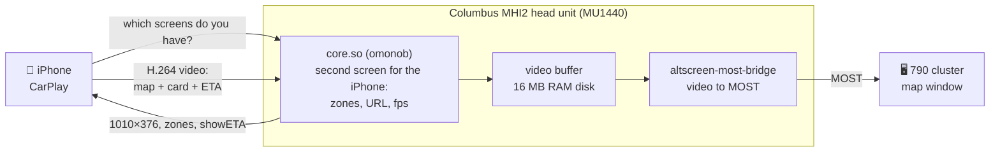
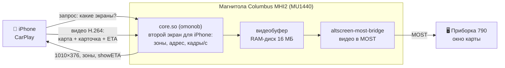

<div align="center">

# MHI2-Carplay-Maps 790

**CarPlay map with turn card and arrival time on the Škoda virtual cockpit**<br>
**CarPlay-карта с карточкой манёвра и временем прибытия на цифровой приборке Škoda**

Columbus MHI2 (MU1440) · 790 cluster (AID 10.25") · based on [omonob/MHI2-Carplay-Maps](https://github.com/omonob/MHI2-Carplay-Maps) 2.0.1

[](https://github.com/sli25555-spec/MHI2-Carplay-Maps-790/releases/latest)
[](https://github.com/sli25555-spec/MHI2-Carplay-Maps-790/releases)
[](LICENSE)


[](https://github.com/omonob/MHI2-Carplay-Maps)

**[⬇️ Download / Скачать](https://github.com/sli25555-spec/MHI2-Carplay-Maps-790/releases/latest)** · [English](#english) · [Русский](#русский)

<sub>Unofficial modification, not affiliated with omonob · Неофициальная модификация, не связана с omonob</sub>

</div>

<p align="center">


</p>

---

## English

**What it is.** omonob's [CarPlay Maps VC 2.0.1](https://github.com/omonob/MHI2-Carplay-Maps) with a few data changes for **Škoda with the Columbus MHI2 head unit (MU1440) and the 790 virtual cockpit**. The iPhone map is shown on the cluster with:

### 🧭 Turn card — arrow, metres, street
### 🕒 Arrival time under the card

## Changes since v1

- **New base: omonob 2.0.1** (was 1.2.2). Adds the Virtual Cockpit settings page in App-Connect; card position Left / Right / Center / Off with automatic zone switching when route guidance starts or ends; Mirroring; capped log size and release of the video buffer.
- **Two variants instead of eight:**
  - **YANDEX-2026** (installed by default) — zones for Yandex Maps, Yandex Navigator and Yango Maps, tuned in the car; arrival time with the Left and Right card; 30 fps.
  - **OMONOB 2.0.1 classic** — omonob's original, unchanged.
- **Switching to the original omonob** is done on the head unit, without reinstalling:
  1. Insert the SD card with this build.
  2. MQB Toolbox → mqbcoding → Customization → CarPlay Maps VC → **cpmap-790-variants**.
  3. Press **OMONOB 2.0.1 classic** and wait for `CPMAP_VARIANT_OK`.
  4. Do a full reboot of the head unit (hold the power button for about 10 s).

  To return to YANDEX-2026, do the same with the **YANDEX-2026** button.
- **Removed:** variants YANDEX11–55 and GOOGLE11–22, the libcardshim library and the CLUSTER_ZOOM setting, the separate RAM-log switch (logging works as in omonob 2.0.1).
- **Installation:** installs over v1 without Restore factory files; the previous version's buttons are removed from the menu automatically. Unplug the CarPlay cable before installing.
- **Documentation:** README and CHANGELOG updated, zone diagrams added for both variants. omonob files in the repository updated to 2.0.1.

| | |
|---|---|
| 🕒 **Arrival time** | shown with the Left and Right card (omonob 2.0.1 has it off) |
| 🎯 **YANDEX-2026 zones** | cursor, card and arrival time placed for Yandex Maps on the 790 cluster, tuned in the car |
| 🎞️ **30 fps** | instead of 60 |
| 🔀 **Variant menu** | YANDEX-2026 or the unchanged omonob 2.0.1, switched from MQB Toolbox |
| ✅ **Everything from omonob 2.0.1** | Virtual Cockpit settings page, card Left / Right / Center / Off, Mirroring, logging and video buffer as in the original |
| ↩️ **Full rollback** | Restore factory files brings back the factory files |

### ⚡ Quick install

1. Download `MHI2-Carplay-Maps-790-v2.zip` from [Releases](https://github.com/sli25555-spec/MHI2-Carplay-Maps-790/releases/latest) and extract it **to the root** of the SD card (FAT32).
2. **Unplug the CarPlay cable.** The installer stops otherwise (`DISCONNECT_CARPLAY_BEFORE_INSTALL`).
3. MQB Toolbox → mqbcoding → Customization → CarPlay Maps VC → **Install AID 10.5** (with a Toolbox from omonob 1.2.x the button is called **Install 790 AID 10.5**).
4. Wait for `CPMAP_INSTALL_OK`, then do a **full reboot** of the head unit (hold the power button for about 10 s).
5. App-Connect settings → **Virtual Cockpit settings** → Navigation card → **Left** or **Right**.

### ✅ After installation the YANDEX-2026 variant is active

It installs over v1 and over omonob 1.2.x / 2.0.x; Restore first is not needed. The buttons of v1 are removed from the menu.

> [!WARNING]
> Modifying head-unit files can cause boot failures. Use at your own risk, with the car parked, on stable power and with a backup. Only the configuration under “Compatibility” has been tested.

<a id="variants-en"></a>
<details>
<summary><b>🔀 Variants and zones</b></summary>

<br>

**How to switch:**
1. Insert the SD card with this build into the head unit. It is needed for switching.
2. MQB Toolbox → mqbcoding → Customization → CarPlay Maps VC → **cpmap-790-variants**.
3. Press the variant's button and wait for `CPMAP_VARIANT_OK`.
4. Do a full reboot of the head unit (hold the power button for about 10 s).

**Show** in the same menu displays the active variant, the card side and how full the RAM disk is. About 80 % while the map is running is normal: that is omonob's 16 MB video buffer.

The **zone** is the area of the cluster video (1010×376) inside which the navigation app places the cursor, the turn card and the arrival time. The map always fills the whole screen. omonob 2.0.1 picks one of five zones by itself, from the card side chosen in Virtual Cockpit settings and from whether CarPlay is guiding a route. Without a route Left, Right and Off share one zone; Center has one zone always.

| Zone (X / Y) | **YANDEX-2026** (default) | **OMONOB 2.0.1 classic** |
|---|---|---|
| No route | 214–820 / 55–339 | 202–808 / 16–360 |
| Left + route | 0–692 / 55–339 | 18–624 / 75–359 |
| Right + route | 346–999 / 55–339 | 386–992 / 75–359 |
| Center | 325–685 / 30–349 | 325–685 / 75–359 |
| Off + route | 42–648 / 16–360 | 42–648 / 16–360 |
| Arrival time | Left and Right | no |
| Frame rate | 30 fps | 60 fps |

<p>


</p>

Card and cursor positions on the diagrams are approximate; iOS and the navigation app decide how they are drawn.

</details>

<details>
<summary><b>✅ Compatibility: what was tested</b></summary>

<br>

**Tested on the author's car:**

| | |
|---|---|
| Car | Škoda Octavia A7 |
| Head unit | Columbus MHI2, train `MHI2_ER_SKG13_P4526_1`, MU1440, hardware H55 |
| Head-unit display | `5E0 919 606 D` |
| Cluster | `5E0 920 790 A` (AID 10.25", profile 790) |
| Phone | iPhone, iOS 27, **over cable** |
| Toolbox | MQB Toolbox 4.2A (included in the archive) |

| Navigation app | Map on cluster | Turn card | Arrival time | Zoom with steering-wheel roller |
|---|---|---|---|---|
| Yandex Navigator / Maps | ✅ | ✅ | ✅ | ❌ (Yandex does not support it) |
| Google Maps | ✅ | ✅ | ✅ | ✅ |
| Amap | ✅ | ✅ | ✅ | ✅ |
| Apple Maps | ✅ | ✅ | ✅ | not tested |

The YANDEX-2026 zones were tuned in the car with Yandex Maps. Google Maps, Amap and Apple Maps were tested with the v1 build; with the YANDEX-2026 zones their cursor may sit a little differently.

**Not tested:** other cars and firmware, the 791 cluster (12.3"), wireless CarPlay adapters. Other projects report that the cluster picture does not get through such adapters.

Tested it on your car? Post in [Discussions](https://github.com/sli25555-spec/MHI2-Carplay-Maps-790/discussions) or [Issues](https://github.com/sli25555-spec/MHI2-Carplay-Maps-790/issues): car, firmware (train, MU), cluster part number, variant, iPhone, navigation app, works or not. **Do not post your VIN, passwords or full dumps.**

</details>

<details>
<summary><b>⚙️ How it works</b></summary>

<br>



1. The iPhone asks the head unit which screens it has. omonob's `core.so` answers: a 1010×376 cluster, its five zones and the card URL. In this build the Left and Right URLs ask for the arrival time (`showETA=yes`).
2. iOS and the navigation app draw a separate map for the cluster and place the cursor, card and arrival time inside the active zone. The iPhone sends it as a video stream.
3. The head unit passes the video to the cluster over the MOST bus. The cluster shows it in the map window and draws its own frames on top: clock, “P”, speed, odometer.

A variant only changes **what the head unit tells the iPhone**. How things are drawn is up to iOS and the navigation app.

</details>

<details>
<summary><b>❓ Questions and problems</b></summary>

<br>

**`DISCONNECT_CARPLAY_BEFORE_INSTALL`.** Unplug the CarPlay cable and press Install again.

**`…CHECKSUM_MISMATCH…` / `…CLASSES_MISSING…` during installation.** Most likely files of an older version are still on the SD card. Delete the `Custom/carplay_maps_vc` folder on the card, extract the whole archive again and repeat Install.

**`PROFILE_MISMATCH` / `UNSUPPORTED_JXE_SIZE`.** The head-unit firmware is not the one this build targets. The installer has not changed anything.

**No map on the cluster.**
- The map only appears once the factory navigation has loaded; wait 1–2 minutes after switching on.
- The iPhone must be connected **by cable**.
- Virtual Cockpit settings: VC Maps must be on.

**No turn card or no arrival time.** Check that a route is set. The arrival time is shown only with the Left and Right card, and not with OMONOB 2.0.1 classic.

**The Yandex cursor sits in different places with and without a route.** That is how Yandex itself behaves: with a route it moves the cursor away from the card.

**How to roll back.** MQB Toolbox → CarPlay Maps VC → **Restore factory files** → `CPMAP_RESTORE_OK` → full reboot. Do not touch the `/mnt/app/carplaymaps` folder by hand: it holds the factory files for the rollback.

</details>

<details>
<summary><b>🛠️ What changed vs omonob 2.0.1</b></summary>

<br>

Details are in [CHANGES.md](skoda-mu1440-790/sd-overlay/Custom/carplay_maps_vc/CHANGES.md). In short:

- **`core.so` (MU1440/790), data only:** the five zones, `maxFPS` 30, and `showETA=yes` in the Left and Right card URLs. Both variants are built reproducibly from the original with [`gen_core201.py`](skoda-mu1440-790/sd-overlay/Custom/carplay_maps_vc/tools/gen_core201.py); OMONOB 2.0.1 classic is byte-identical to the original.
- **Installer:** adds the variant name to the version, installs the variant menu and removes buttons of older builds. The change is a diff in [`patches/`](skoda-mu1440-790/sd-overlay/Custom/carplay_maps_vc/patches).
- **Variant menu** `cpmap-790-variants` in MQB Toolbox.

All other files in the archive are byte-identical to omonob's full v2.0.1 package. No code from other projects is added. Version history is in [CHANGELOG.md](CHANGELOG.md).

</details>

<details>
<summary><b>📁 What is where in the repository</b></summary>

<br>

```text
skoda-mu1440-790/          ← THIS BUILD
├── sd-overlay/            files changed/added vs omonob 2.0.1, as on the SD card
│   └── Custom/carplay_maps_vc/
│       ├── payload/       installer and the default core.so (YANDEX-2026)
│       ├── variants790/   core.so of each variant
│       ├── menu790/       MQB Toolbox menu
│       ├── tools/         gen_core201.py: builds the variants from omonob's core.so
│       ├── patches/       installer change as a diff
│       └── CHANGES.md     detailed list of changes
└── docs/zones/            zone diagrams
CHANGELOG.md               version history of this build
README.md                  this file
README.omonob.md           omonob's original README (unchanged)

MU1102/ MU1367/ MU1440_SKODA/ src/ tests/ tools/ docs/ assets/ examples/ releases/
                           ← omonob 2.0.1 sources and materials, UNCHANGED
LICENSE                    GPL-3.0 (same as the original)
```

The ready-made SD-card archive is in [Releases](https://github.com/sli25555-spec/MHI2-Carplay-Maps-790/releases/latest).

</details>

---

## Русский

**Что это.** [CarPlay Maps VC 2.0.1](https://github.com/omonob/MHI2-Carplay-Maps) автора **omonob** с небольшими правками данных под **Škoda с магнитолой Columbus MHI2 (MU1440) и приборкой 790**. Карта из iPhone выводится на приборку, и на ней видно:

### 🧭 Карточку манёвра — стрелка, метры, улица
### 🕒 Время прибытия под карточкой
## Изменения в v2 по сравнению с v1

- **Новая база — omonob 2.0.1** (вместо 1.2.2). Добавлены: страница Virtual Cockpit settings в App-Connect; выбор положения карточки Left / Right / Center / Off с автоматической сменой зоны при начале и окончании ведения по маршруту; Mirroring; ограничение размера логов и освобождение видеобуфера.
- **Два варианта вместо восьми:**
  - **YANDEX-2026** (устанавливается по умолчанию) — зоны под Яндекс Карты, Яндекс Навигатор и Yango Maps, подобранные в автомобиле; время прибытия при карточке Left и Right; 30 кадров/с.
  - **OMONOB 2.0.1 classic** — оригинальная версия omonob без изменений.
- **Переключение на оригинальный omonob** выполняется прямо в магнитоле, без переустановки:
  1. Вставьте SD-карту с этой сборкой.
  2. MQB Toolbox → mqbcoding → Customization → CarPlay Maps VC → **cpmap-790-variants**.
  3. Нажмите **OMONOB 2.0.1 classic** и дождитесь `CPMAP_VARIANT_OK`.
  4. Выполните полную перезагрузку магнитолы (удерживать кнопку питания ~10 с).

  Возврат к YANDEX-2026 — так же, кнопкой **YANDEX-2026**.
- **Удалено:** варианты YANDEX11–55 и GOOGLE11–22, библиотека libcardshim и параметр CLUSTER_ZOOM, отдельный переключатель RAM-логов (логи работают как в omonob 2.0.1).
- **Установка:** поверх v1 без Restore factory files, кнопки предыдущей версии удаляются из меню автоматически. Перед установкой отключите кабель CarPlay.
- **Документация:** обновлены README и CHANGELOG, добавлены схемы зон обоих вариантов. Файлы omonob в репозитории обновлены до версии 2.0.1.

| | |
|---|---|
| 🕒 **Время прибытия** | при карточке Left и Right (в omonob 2.0.1 выключено) |
| 🎯 **Зоны YANDEX-2026** | курсор, карточка и время прибытия расставлены под Яндекс Карты на приборке 790, подобраны в машине |
| 🎞️ **30 кадров/с** | вместо 60 |
| 🔀 **Меню вариантов** | YANDEX-2026 или omonob 2.0.1 без изменений, переключение из MQB Toolbox |
| ✅ **Всё из omonob 2.0.1** | страница Virtual Cockpit settings, карточка Left / Right / Center / Off, Mirroring, логи и видеобуфер как в оригинале |
| ↩️ **Полный откат** | Restore factory files возвращает заводские файлы |

### ⚡ Быстрая установка

1. Скачайте `MHI2-Carplay-Maps-790-v2.zip` из [Releases](https://github.com/sli25555-spec/MHI2-Carplay-Maps-790/releases/latest) и распакуйте **в корень** SD-карты (FAT32).
2. **Выньте кабель CarPlay.** Иначе установщик остановится (`DISCONNECT_CARPLAY_BEFORE_INSTALL`).
3. MQB Toolbox → mqbcoding → Customization → CarPlay Maps VC → **Install AID 10.5** (если Toolbox ставился с omonob 1.2.x, кнопка называется **Install 790 AID 10.5**).
4. Дождитесь `CPMAP_INSTALL_OK` и сделайте **полную перезагрузку** магнитолы (держать кнопку питания ~10 с).
5. Настройки App-Connect → **Virtual Cockpit settings** → Navigation card → **Left** или **Right**.

### ✅ После установки включён вариант YANDEX-2026

Ставится поверх v1 и поверх omonob 1.2.x / 2.0.x, Restore перед этим не нужен. Кнопки v1 из меню удаляются.

> [!WARNING]
> Изменение файлов магнитолы может привести к сбоям загрузки. Всё на свой риск: на стоящей машине, при стабильном питании, с бэкапом. Проверено только на конфигурации из раздела «Совместимость».

<a id="variants"></a>
<details>
<summary><b>🔀 Варианты и зоны</b></summary>

<br>

**Как переключить:**
1. Вставьте SD-карту с этой сборкой в магнитолу. Она нужна для переключения.
2. MQB Toolbox → mqbcoding → Customization → CarPlay Maps VC → **cpmap-790-variants**.
3. Нажмите кнопку нужного варианта и дождитесь `CPMAP_VARIANT_OK`.
4. Сделайте полную перезагрузку магнитолы (держать кнопку питания ~10 с).

**Show** в том же меню показывает вариант, сторону карточки и заполненность RAM-диска. Около 80 % при работающей карте — это нормально: столько занимает видеобуфер omonob (16 МБ).

**Зона** — область видео приборки (1010×376), внутри которой навигатор ставит курсор, карточку и время прибытия. Карта при этом всегда на весь экран. omonob 2.0.1 сам выбирает одну из пяти зон: по стороне карточки в Virtual Cockpit settings и по тому, ведёт ли CarPlay по маршруту. Без маршрута у Left, Right и Off зона общая, у Center зона одна всегда.

| Зона (X / Y) | **YANDEX-2026** (по умолчанию) | **OMONOB 2.0.1 classic** |
|---|---|---|
| Без маршрута | 214–820 / 55–339 | 202–808 / 16–360 |
| Left с маршрутом | 0–692 / 55–339 | 18–624 / 75–359 |
| Right с маршрутом | 346–999 / 55–339 | 386–992 / 75–359 |
| Center | 325–685 / 30–349 | 325–685 / 75–359 |
| Off с маршрутом | 42–648 / 16–360 | 42–648 / 16–360 |
| Время прибытия | Left и Right | нет |
| Кадров/с | 30 | 60 |

<p>


</p>

Положение карточки и курсора на схемах приблизительное: как их рисовать, решают iOS и навигатор.

</details>

<details>
<summary><b>✅ Совместимость: что проверено</b></summary>

<br>

**Проверено на машине автора сборки:**

| | |
|---|---|
| Машина | Škoda Octavia A7 |
| Магнитола | Columbus MHI2, train `MHI2_ER_SKG13_P4526_1`, MU1440, железо H55 |
| Экран магнитолы | `5E0 919 606 D` |
| Приборка | `5E0 920 790 A` (AID 10,25", профиль 790) |
| Телефон | iPhone, iOS 27, **по кабелю** |
| Toolbox | MQB Toolbox 4.2A (в составе архива) |

| Навигатор | Карта на приборке | Карточка манёвра | Время прибытия | Масштаб колёсиком руля |
|---|---|---|---|---|
| Яндекс Навигатор / Карты | ✅ | ✅ | ✅ | ❌ (Яндекс не поддерживает) |
| Google Maps | ✅ | ✅ | ✅ | ✅ |
| Amap | ✅ | ✅ | ✅ | ✅ |
| Apple Карты | ✅ | ✅ | ✅ | не проверялось |

Зоны YANDEX-2026 подобраны в машине под Яндекс Карты. Google Maps, Amap и Apple Карты проверялись на сборке v1; с зонами YANDEX-2026 курсор у них может стоять чуть иначе.

**Не проверялось:** другие машины и прошивки, приборка 791 (12,3"), беспроводные CarPlay-адаптеры. По опыту других проектов, картинка на приборку через них не идёт.

Проверили на своей машине? Напишите в [Discussions](https://github.com/sli25555-spec/MHI2-Carplay-Maps-790/discussions) или [Issues](https://github.com/sli25555-spec/MHI2-Carplay-Maps-790/issues): машина, прошивка (train, MU), номер приборки, вариант, iPhone, навигатор, работает или нет. **VIN, пароли и полные дампы не публикуйте.**

</details>

<details>
<summary><b>⚙️ Как это работает</b></summary>

<br>



1. iPhone спрашивает магнитолу, какие у неё есть экраны. `core.so` omonob отвечает: есть приборка 1010×376, вот её пять зон и адрес карточки. В этой сборке адреса для Left и Right просят время прибытия (`showETA=yes`).
2. iOS и навигатор рисуют для приборки отдельную карту. Курсор, карточку и время прибытия они ставят внутри текущей зоны. Всё это iPhone присылает видеопотоком.
3. Магнитола передаёт видео по шине MOST в приборку. Приборка показывает его в окне карты и рисует поверх свои рамки: часы, «P», скорость, пробег.

Поэтому вариант меняет только то, **что магнитола сообщает iPhone**. Как именно рисовать, решают iOS и навигатор.

</details>

<details>
<summary><b>❓ Вопросы и проблемы</b></summary>

<br>

**`DISCONNECT_CARPLAY_BEFORE_INSTALL`.** Выньте кабель CarPlay и нажмите Install ещё раз.

**При установке `…CHECKSUM_MISMATCH…` / `…CLASSES_MISSING…`.** Скорее всего, на SD-карте остались файлы старой версии. Удалите на карте папку `Custom/carplay_maps_vc`, распакуйте архив заново целиком и повторите Install.

**`PROFILE_MISMATCH` / `UNSUPPORTED_JXE_SIZE`.** Прошивка магнитолы не та, под которую сделана сборка. Установщик ничего не менял.

**Карты на приборке нет.**
- Карта появляется только после загрузки штатной навигации, подождите 1–2 минуты после включения.
- iPhone должен быть подключён **кабелем**.
- В Virtual Cockpit settings должно быть включено VC Maps.

**Нет карточки или времени прибытия.** Проверьте, что маршрут построен. Время прибытия показывается только при карточке Left и Right и не показывается в OMONOB 2.0.1 classic.

**Курсор Яндекса без маршрута и с маршрутом стоит в разных местах.** Так ведёт себя сам Яндекс: с маршрутом он отодвигает курсор от карточки.

**Как откатиться.** MQB Toolbox → CarPlay Maps VC → **Restore factory files** → `CPMAP_RESTORE_OK` → полная перезагрузка. Папку `/mnt/app/carplaymaps` руками не трогайте: в ней лежат заводские файлы для отката.

</details>

<details>
<summary><b>🛠️ Что изменено относительно omonob 2.0.1</b></summary>

<br>

Подробно — в [CHANGES.md](skoda-mu1440-790/sd-overlay/Custom/carplay_maps_vc/CHANGES.md). Кратко:

- **`core.so` (MU1440/790), только данные:** пять зон, `maxFPS` 30 и `showETA=yes` в адресах карточки Left и Right. Оба варианта воспроизводимо собираются из оригинала скриптом [`gen_core201.py`](skoda-mu1440-790/sd-overlay/Custom/carplay_maps_vc/tools/gen_core201.py); OMONOB 2.0.1 classic побайтно совпадает с оригиналом.
- **Установщик:** дописывает вариант в версию, ставит меню вариантов и удаляет кнопки старых сборок. Изменение в виде diff — в [`patches/`](skoda-mu1440-790/sd-overlay/Custom/carplay_maps_vc/patches).
- **Меню вариантов** `cpmap-790-variants` в MQB Toolbox.

Остальные файлы архива побайтно совпадают с полным архивом omonob v2.0.1. Кода других проектов нет. История версий — в [CHANGELOG.md](CHANGELOG.md).

</details>

<details>
<summary><b>📁 Что где лежит в репозитории</b></summary>

<br>

```text
skoda-mu1440-790/          ← ЭТА СБОРКА
├── sd-overlay/            файлы, изменённые и добавленные относительно omonob 2.0.1, как на SD-карте
│   └── Custom/carplay_maps_vc/
│       ├── payload/       установщик и core.so по умолчанию (YANDEX-2026)
│       ├── variants790/   core.so каждого варианта
│       ├── menu790/       меню MQB Toolbox
│       ├── tools/         gen_core201.py: собирает варианты из core.so omonob
│       ├── patches/       изменение установщика в виде diff
│       └── CHANGES.md     подробный список изменений
└── docs/zones/            схемы зон
CHANGELOG.md               история версий этой сборки
README.md                  этот файл
README.omonob.md           оригинальный README omonob (без изменений)

MU1102/ MU1367/ MU1440_SKODA/ src/ tests/ tools/ docs/ assets/ examples/ releases/
                           ← исходники и материалы omonob 2.0.1, БЕЗ изменений
LICENSE                    GPL-3.0 (как у оригинала)
```

Готовый архив для SD-карты лежит в [Releases](https://github.com/sli25555-spec/MHI2-Carplay-Maps-790/releases/latest).

</details>

---

## License / Лицензия

[GNU GPL v3.0](LICENSE), same as the original project [omonob/MHI2-Carplay-Maps](https://github.com/omonob/MHI2-Carplay-Maps); omonob's original README is kept as [README.omonob.md](README.omonob.md). The MQB Toolbox (jilleb) in the archive keeps its MIT license.

GNU GPL v3.0, как у оригинального проекта. MQB Toolbox (jilleb) в архиве сохраняет свою лицензию MIT.

Škoda, Volkswagen, Apple, CarPlay, Yandex and Google are trademarks of their respective owners and are mentioned only to describe compatibility. / Товарные знаки принадлежат своим владельцам и упомянуты только для описания совместимости.
