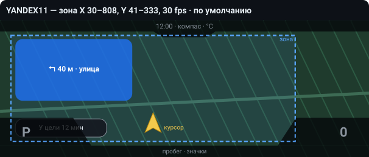
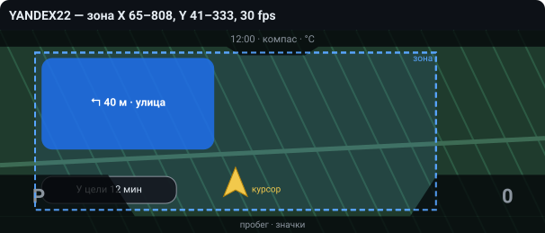
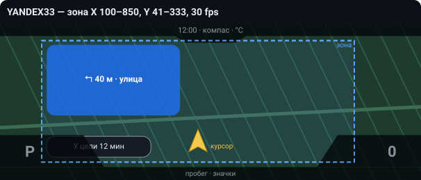
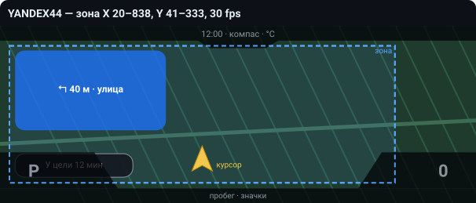
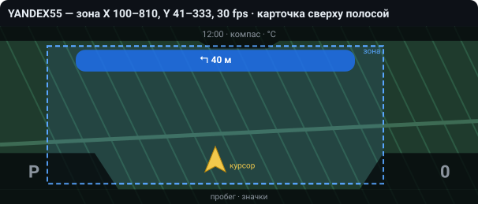
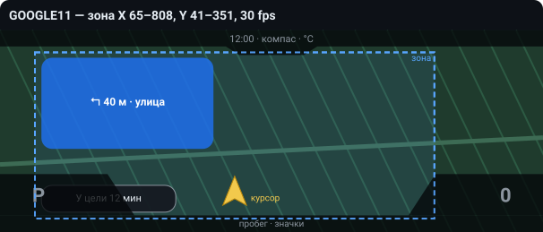
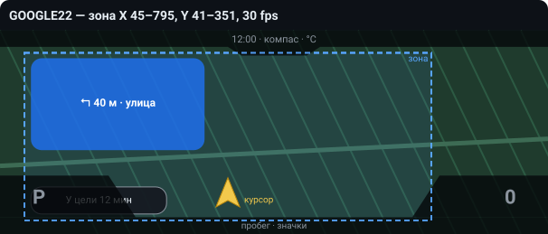
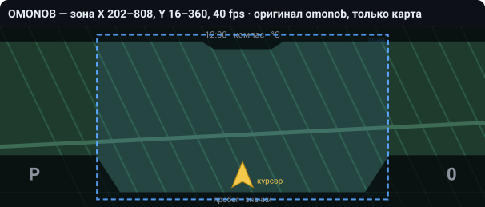
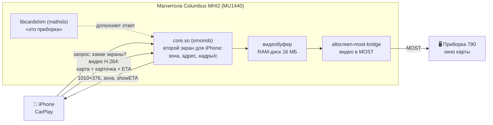

<div align="center">

# MHI2-Carplay-Maps 790

**CarPlay-карта с карточкой манёвра и временем прибытия на цифровой приборке Škoda**<br>
**CarPlay map with turn card and arrival time on the Škoda virtual cockpit**

Columbus MHI2 (MU1440) · приборка 790 (AID 10,25") · на основе [omonob/MHI2-Carplay-Maps](https://github.com/omonob/MHI2-Carplay-Maps) 1.2.2

[](https://github.com/sli25555-spec/MHI2-Carplay-Maps-790/releases/latest)
[](https://github.com/sli25555-spec/MHI2-Carplay-Maps-790/releases)
[](LICENSE)


[](https://github.com/omonob/MHI2-Carplay-Maps)

**[⬇️ Скачать / Download](https://github.com/sli25555-spec/MHI2-Carplay-Maps-790/releases/latest)** · [Русский](#русский) · [English](#english)

<sub>Неофициальная модификация, не связана с omonob · Unofficial modification, not affiliated with omonob</sub>

</div>

<!--
  ФОТО / СКРИНШОТЫ — вставить сюда (откройте README на GitHub → карандаш → перетащите картинки в это место):
  1) главное фото приборки: Яндекс, карточка + «У цели N мин»
  2) Google Maps на приборке
  3) по желанию: короткая GIF / видео (переключение варианта или езда с маршрутом)
  Советую оформить их так (GitHub подставит ссылки сам после перетаскивания):
  <p align="center"> </p>
-->

---

## Русский

**Что это.** Сборка [CarPlay Maps VC](https://github.com/omonob/MHI2-Carplay-Maps) автора **omonob** под **Škoda с магнитолой Columbus MHI2 (MU1440) и приборкой 790**. Карта из iPhone выводится на приборку, и на ней видно:
- 🧭 **карточку манёвра** (стрелка, метры, улица);
- 🕒 **время до цели**.

Протестировано на Яндекс Навигаторе, Google Maps, Amap и Apple Картах.

| | |
|---|---|
| 🗺️ **Карточка манёвра и время прибытия** | рисует сам iPhone, прямо в карте на приборке |
| 🎯 **Зоны под Яндекс, Google и Apple** | курсор выше и ближе к центру, карточка у края |
| 🔀 **8 вариантов в меню** | переключаются из MQB Toolbox без переустановки |
| 🧹 **RAM-логи выключены** | RAM-диск магнитолы (20 МБ) не переполняется при долгой езде |
| ↩️ **Полный откат** | Restore factory files возвращает заводские файлы |

### ⚡ Быстрая установка

1. Скачайте `MHI2-Carplay-Maps-790-v1.zip` из [Releases](https://github.com/sli25555-spec/MHI2-Carplay-Maps-790/releases/latest) и распакуйте **в корень** SD-карты (FAT32).
2. MQB Toolbox → mqbcoding → Customization → CarPlay Maps VC → **Install 790 AID 10.5**.
3. Дождитесь `CPMAP_INSTALL_OK` и сделайте **полную перезагрузку** магнитолы (держать кнопку питания ~10 с).

После установки включён вариант **YANDEX11** (под Яндекс Навигатор).
**Пользуетесь Google Maps или не устраивает положение курсора — переключите вариант:**
MQB Toolbox → mqbcoding → Customization → CarPlay Maps VC → **cpmap-790-variants** → кнопка нужного варианта → дождаться `CPMAP_VARIANT_OK` → полная перезагрузка.
Какой вариант что делает — в разделе [«Как переключать варианты: схемы зон»](#variants) ниже.

> [!WARNING]
> Изменение файлов магнитолы может привести к сбоям загрузки. Всё на свой риск: на стоящей машине, при стабильном питании, с бэкапом. Проверено только на конфигурации из раздела «Совместимость».

<a id="variants"></a>
<details>
<summary><b>🔀 Как переключать варианты: схемы зон</b></summary>

<br>

> [!IMPORTANT]
> **При установке ставится YANDEX11. Если вы пользователь Google Maps — выберите свой вариант ниже: GOOGLE11 или GOOGLE22!**

**Как переключить:**
1. Вставьте SD-карту с этой сборкой в магнитолу. Она нужна для переключения.
2. MQB Toolbox → mqbcoding → Customization → CarPlay Maps VC → **cpmap-790-variants**.
3. Нажмите кнопку нужного варианта и дождитесь `CPMAP_VARIANT_OK`.
4. Сделайте полную перезагрузку магнитолы (держать кнопку питания ~10 с).

Кнопка **Show** в том же меню показывает, какой вариант сейчас стоит.

**Зона** — область видео приборки (1010×376), внутри которой навигатор ставит курсор, карточку и время прибытия. Карта при этом всегда на весь экран.
- карточка висит от левого верхнего угла зоны;
- время прибытия — от левого нижнего;
- курсор ставится ближе к низу зоны.

Тёмные области на схемах — рамки приборки (часы, «P», скорость, пробег). Положение карточки, курсора и рамок приблизительное, по фото.

| Вариант | Зона X | Зона Y | Карточка | Время прибытия |
|---|---|---|---|---|
| **YANDEX11** (по умолчанию) — всё ± по центру | 30–808 | 41–333 | слева сверху | да |
| **YANDEX22** — всё чуть сдвинуто вправо | 65–808 | 41–333 | слева сверху | да |
| **YANDEX33** — стрелка по центру только без маршрута | 100–850 | 41–333 | слева сверху | да |
| **YANDEX44** — стрелка точно по центру только при ведении по маршруту | 20–838 | 41–333 | слева сверху | да |
| **YANDEX55** — подсказки сверху, стрелка всегда по центру | 100–810 | 41–333 | сверху полосой | нет |
| **GOOGLE11** — всё ± по центру | 65–808 | 41–351 | слева сверху | да |
| **GOOGLE22** — стрелка точно по центру только при ведении по маршруту | 45–795 | 41–351 | слева сверху | да |
| **OMONOB 1.2.2 classic** — оригинал omonob, только карта | 202–808 | 16–360 | нет | нет |

<p>








</p>

Ещё в меню:
- **RAM logs: OFF / ON** — работает с любым вариантом. ON нужен только для диагностики;
- **Show** — показывает вариант, состояние логов и заполненность RAM-диска в %.

</details>

<details>
<summary><b>✅ Совместимость: что проверено</b></summary>

<br>

**Проверено на машине автора сборки:**

| | |
|---|---|
| Машина | Škoda Octavia A7 |
| Магнитола | Columbus MHI2, train `MHI2_ER_SKG13_P4526_1`, MU1440, железо H55 |
| Экран магнитолы | `5E0 919 606 D` |
| Приборка | `5E0 920 790 A` (AID 10,25", профиль 790) |
| Телефон | iPhone, iOS 27, **по кабелю** |
| Toolbox | MQB Toolbox 4.2A (в составе архива) |

| Навигатор | Карта на приборке | Карточка манёвра | Время прибытия | Масштаб колёсиком руля |
|---|---|---|---|---|
| Яндекс Навигатор / Карты | ✅ | ✅ | ✅ | ❌ (Яндекс не поддерживает) |
| Google Maps | ✅ | ✅ | ✅ | ✅ |
| Amap | ✅ | ✅ | ✅ | ✅ |
| 2ГИС | ✅ | не проверялось | не проверялось | ❌ |
| Apple Карты | ✅ | ✅ | ✅ | не проверялось |

**Не проверялось:** другие машины и прошивки, приборка 791 (12,3"), беспроводные CarPlay-адаптеры (по опыту других проектов картинка на приборку через них не идёт).

Проверили на своей машине? Напишите в [Discussions](https://github.com/sli25555-spec/MHI2-Carplay-Maps-790/discussions) или [Issues](https://github.com/sli25555-spec/MHI2-Carplay-Maps-790/issues): машина, прошивка (train, MU), номер приборки, вариант, iPhone, навигатор, работает или нет. **VIN, пароли и полные дампы не публикуйте.**

</details>

<details>
<summary><b>⚙️ Как это работает</b></summary>

<br>



1. iPhone спрашивает магнитолу, какие у неё есть экраны. `core.so` отвечает: есть приборка 1010×376, вот её зона и адрес `maps:/car/instrumentcluster?showETA=yes`. Шим добавляет к ответу «это Instrument Cluster».
2. iOS и навигатор рисуют для приборки отдельную карту. Курсор, карточку и время прибытия они ставят внутри зоны. Всё это iPhone присылает видеопотоком.
3. Магнитола передаёт видео по шине MOST в приборку. Приборка показывает его в окне карты и рисует поверх свои рамки: часы, «P», скорость, пробег.

Поэтому вариант меняет только то, **что магнитола сообщает iPhone**. Как именно рисовать, решают iOS и навигатор.

</details>

<details>
<summary><b>❓ Вопросы и проблемы</b></summary>

<br>

**При установке `…CHECKSUM_MISMATCH…` / `…CLASSES_MISSING…`.** Скорее всего, на SD-карте остались файлы старой версии. Отформатируйте карту, распакуйте архив заново целиком и повторите Install 790.

**`PROFILE_MISMATCH` / `UNSUPPORTED_JXE_SIZE`.** Прошивка магнитолы не та, под которую сделана сборка. Установщик ничего не менял.

**Карты на приборке нет.**
- Карта появляется только после загрузки штатной навигации, подождите 1–2 минуты после включения.
- iPhone должен быть подключён **кабелем**.

**Нет карточки манёвра.** Проверьте, что маршрут построен и что выбран не OMONOB (у него карточки нет). Цвет и размер карточки выбирают iOS и навигатор.

**Курсор Яндекса без маршрута и с маршрутом стоит в разных местах.** Так ведёт себя сам Яндекс: с маршрутом он отодвигает курсор от карточки. Попробуйте YANDEX55 (карточка сверху) или другой вариант зоны.

**Время прибытия частично закрыто «P».** Это рамка приборки поверх видео. Его положение зависит от левого нижнего угла зоны.

**CarPlay подвисает при долгой езде.** Проверьте **Show**: если RAM-диск заполнен на 90–100 %, включены логи. Нажмите **RAM logs: OFF** и перезагрузите магнитолу.

**Как откатиться.** MQB Toolbox → CarPlay Maps VC → **Restore factory files** → `CPMAP_RESTORE_OK` → полная перезагрузка. Папку `/mnt/app/carplaymaps` руками не трогайте: в ней лежат заводские файлы для отката.

**Как прислать логи для разбора.** Нажмите **RAM logs: ON**, перезагрузитесь, повторите проблему и сохраните логи. После этого верните **OFF**.

</details>

<details>
<summary><b>🛠️ Что изменено относительно omonob 1.2.2</b></summary>

<br>

Подробно — в [skoda-mu1440-790/CHANGES.md](skoda-mu1440-790/CHANGES.md). Кратко:

- **`core.so` (MU1440/790), правка бинарного файла:**
  - безопасная зона;
  - частота кадров;
  - адрес экрана приборки с параметрами `showETA` / `maneuverLayout`.
  
  Все варианты воспроизводимо собираются из оригинала: [`tools/build_790_variants.py`](skoda-mu1440-790/tools/build_790_variants.py). Вариант OMONOB побайтно совпадает с оригиналом.
- **`libcardshim.so`** из [mathsls/MHI2-Carplay-Maps](https://github.com/mathsls/MHI2-Carplay-Maps) (GPL-3.0). Исходник лежит в [`third_party/`](skoda-mu1440-790/third_party/mathsls-cardshim).
- **`carplay-cluster-supervisor.nolog`**: лог моста идёт в `/dev/null`, способ mathsls. Скрипт: [`tools/patch_supervisor.py`](skoda-mu1440-790/tools/patch_supervisor.py).
- **Установщик и обёртка `dio_manager`**: изменения в виде diff в [`patches/`](skoda-mu1440-790/patches).

Остальные файлы архива побайтно совпадают с полным архивом omonob v1.2.2. История версий — в [CHANGELOG.md](CHANGELOG.md).

</details>

<details>
<summary><b>📁 Что где лежит в репозитории</b></summary>

<br>

```text
skoda-mu1440-790/          ← ЭТА СБОРКА
├── sd-overlay/            файлы, изменённые и добавленные относительно omonob 1.2.2 (как на SD-карте)
├── tools/                 скрипты: собрать варианты core.so и патч supervisor из оригиналов omonob
├── patches/               изменения установщика и обёртки в виде diff
├── third_party/           исходник libcardshim (mathsls, GPL-3.0)
├── docs/zones/            схемы зон вариантов
└── CHANGES.md             подробный список изменений
CHANGELOG.md               история версий этой сборки
README.md                  этот файл
README.omonob.md           оригинальный README omonob (без изменений)

MU1102/ MU1367/ MU1440_SKODA/ src/ tests/ tools/ assets/ releases/
                           ← исходники и материалы omonob 1.2.2, БЕЗ изменений
LICENSE                    GPL-3.0 (как у оригинала)
```

Готовый архив для SD-карты лежит не в коде, а в [Releases](https://github.com/sli25555-spec/MHI2-Carplay-Maps-790/releases/latest).

</details>

---

## English

<details>
<summary><b>English version (click to expand)</b></summary>

<br>

**What it is.** An unofficial build of omonob's [CarPlay Maps VC](https://github.com/omonob/MHI2-Carplay-Maps) v1.2.2 for **Škoda Columbus MHI2 (MU1440) with the 790 virtual cockpit (AID 10.25")**.

**What it adds to the original:**
- a turn card and an arrival-time bar on the cluster (tested with Yandex Navigator, Google Maps, Amap and Apple Maps);
- safe areas tuned for Yandex and Google;
- 8 variants you can switch from MQB Toolbox;
- RAM-disk logs off by default.

**Install:**
1. Extract `MHI2-Carplay-Maps-790-v1.zip` from [Releases](https://github.com/sli25555-spec/MHI2-Carplay-Maps-790/releases/latest) to the SD-card root.
2. MQB Toolbox → mqbcoding → Customization → CarPlay Maps VC → **Install 790 AID 10.5**.
3. Wait for `CPMAP_INSTALL_OK`, then do a full reboot (hold the power button for about 10 s).

The default is YANDEX11. **Google Maps users:** switch to GOOGLE11 or GOOGLE22 in CarPlay Maps VC → cpmap-790-variants, then do a full reboot.

Default variant: YANDEX11, RAM logs off. To undo, use **Restore factory files**.

**Tested on:** Škoda Octavia A7, `MHI2_ER_SKG13_P4526_1`, MU1440, cluster `5E0 920 790 A`, iPhone over cable. Nothing else has been tested.

**Variants:** see the zone diagrams above. The zone is the safe area in the 1010×376 cluster video. The card hangs from the zone's top-left corner and the ETA bar from its bottom-left corner.

**Changes vs omonob 1.2.2:**
- `core.so`: safe area, maxFPS and cluster URL. The variants are reproducible with `tools/build_790_variants.py`.
- mathsls libcardshim (GPL-3.0), source included.
- mathsls supervisor RAM-log patch.
- Installer and wrapper diffs in `patches/`.

All other files are byte-identical to omonob's v1.2.2 package. See [CHANGES.md](skoda-mu1440-790/CHANGES.md).

**Disclaimer.** Modifying head-unit files can cause boot failures. Use at your own risk, with the car parked and on stable power. Trademarks belong to their owners.

</details>

---

## Благодарности / Credits

- **[omonob](https://github.com/omonob/MHI2-Carplay-Maps)** — CarPlay Maps VC, основа сборки. Оригинальный README: [README.omonob.md](README.omonob.md).
- **[mathsls](https://github.com/mathsls/MHI2-Carplay-Maps)** — libcardshim, URL карточки, исправление RAM-логов.
- **[perkthefox](https://github.com/perkthefox/mst2-cluster-nav)** — параметры `showETA` / `maneuverLayout` и сведения об этой приборке (только информация, код не использовался).
- **[chefranov](https://github.com/chefranov/mhi2-au37x-carplay)**, **[kamgurgul](https://github.com/kamgurgul/mhi2_altscreen_carplay)** — сведения о параметрах приборки и MU1440 (код не использовался).
- **jilleb** — [MQB Toolbox](https://github.com/jilleb/mib2-toolbox) (MIT), входит в архив для SD.

## Лицензия / License

[GNU GPL v3.0](LICENSE), как у оригинального проекта. Сторонние части сохраняют свои лицензии: libcardshim (mathsls) — GPL-3.0, MQB Toolbox — MIT.
Škoda, Volkswagen, Apple, CarPlay, Яндекс и Google — товарные знаки своих владельцев, упомянуты только для описания совместимости.
