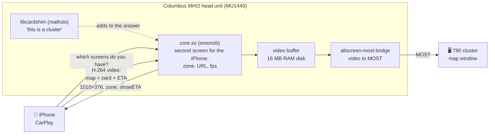
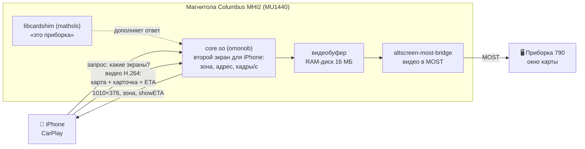

<div align="center">

# MHI2-Carplay-Maps 790

**CarPlay map with turn card and arrival time on the Škoda virtual cockpit**<br>
**CarPlay-карта с карточкой манёвра и временем прибытия на цифровой приборке Škoda**

Columbus MHI2 (MU1440) · 790 cluster (AID 10.25") · based on [omonob/MHI2-Carplay-Maps](https://github.com/omonob/MHI2-Carplay-Maps) 1.2.2

[](https://github.com/sli25555-spec/MHI2-Carplay-Maps-790/releases/latest)
[](https://github.com/sli25555-spec/MHI2-Carplay-Maps-790/releases)
[](LICENSE)


[](https://github.com/omonob/MHI2-Carplay-Maps)

**[⬇️ Download / Скачать](https://github.com/sli25555-spec/MHI2-Carplay-Maps-790/releases/latest)** · [English](#english) · [Русский](#русский)

<sub>Unofficial modification, not affiliated with omonob · Неофициальная модификация, не связана с omonob</sub>

</div>

<p align="center">


</p>

---

## English

**What it is.** A build of omonob's [CarPlay Maps VC](https://github.com/omonob/MHI2-Carplay-Maps) for **Škoda with the Columbus MHI2 head unit (MU1440) and the 790 virtual cockpit**. The iPhone map is shown on the cluster, and on it you see:

### 🧭 Turn card — arrow, metres, street
### 🕒 Time to destination

Tested with Yandex Navigator, Google Maps, Amap and Apple Maps.

| | |
|---|---|
| 🗺️ **Turn card and arrival time** | drawn by the iPhone itself, right in the cluster map |
| 🎯 **Zones for Yandex, Google and Apple** | cursor higher and closer to the centre, card at the edge |
| 🔀 **8 variants in the menu** | switched from MQB Toolbox without reinstalling |
| 🧹 **RAM logs off** | the head unit's 20 MB RAM disk does not fill up on long drives |
| ↩️ **Full rollback** | Restore factory files brings back the factory files |

### ⚡ Quick install

1. Download `MHI2-Carplay-Maps-790-v1.zip` from [Releases](https://github.com/sli25555-spec/MHI2-Carplay-Maps-790/releases/latest) and extract it **to the root** of the SD card (FAT32).
2. MQB Toolbox → mqbcoding → Customization → CarPlay Maps VC → **Install 790 AID 10.5**.
3. Wait for `CPMAP_INSTALL_OK`, then do a **full reboot** of the head unit (hold the power button for about 10 s).

### ✅ After installation the YANDEX11 variant is active (for Yandex Navigator)

### 🔀 If you use Google Maps, Apple Maps, Amap, etc. — switch to GOOGLE11 or GOOGLE22

**All variants differ from each other mainly in where the cursor arrow sits.**

**MQB Toolbox → mqbcoding → Customization → CarPlay Maps VC → cpmap-790-variants → the variant's button → wait for `CPMAP_VARIANT_OK` → full reboot.**

**What each variant does: see [“How to switch variants: zone diagrams”](#variants-en) below.**

> [!WARNING]
> Modifying head-unit files can cause boot failures. Use at your own risk, with the car parked, on stable power and with a backup. Only the configuration under “Compatibility” has been tested.

<a id="variants-en"></a>
<details>
<summary><b>🔀 How to switch variants: zone diagrams</b></summary>

<br>

### ❗ Installation sets YANDEX11. If you use Google Maps, Apple Maps, Amap, etc., pick your variant below: GOOGLE11 or GOOGLE22!

**How to switch:**
1. Insert the SD card with this build into the head unit. It is needed for switching.
2. MQB Toolbox → mqbcoding → Customization → CarPlay Maps VC → **cpmap-790-variants**.
3. Press the variant's button and wait for `CPMAP_VARIANT_OK`.
4. Do a full reboot of the head unit (hold the power button for about 10 s).

The **Show** button in the same menu shows which variant is active.

The **zone** is the area of the cluster video (1010×376) inside which the navigation app places the cursor, the turn card and the arrival time. The map always fills the whole screen.
- the card hangs from the zone's top-left corner;
- the arrival time sits at its bottom-left corner;
- the cursor is placed near the bottom of the zone.

The dark areas on the diagrams are the cluster's own frames (clock, “P”, speed, odometer). Card, cursor and frame positions are approximate, taken from photos.

| Variant | Zone X | Zone Y | Turn card | Arrival time |
|---|---|---|---|---|
| **YANDEX11** (default) — everything roughly centred | 30–808 | 41–333 | top left | yes |
| **YANDEX22** — everything shifted slightly to the right | 65–808 | 41–333 | top left | yes |
| **YANDEX33** — arrow centred only when no route is set | 100–850 | 41–333 | top left | yes |
| **YANDEX44** — arrow exactly centred only while following a route | 20–838 | 41–333 | top left | yes |
| **YANDEX55** — hints at the top, arrow always centred | 100–810 | 41–333 | top strip | no |
| **GOOGLE11** — everything roughly centred | 65–808 | 41–351 | top left | yes |
| **GOOGLE22** — arrow exactly centred only while following a route | 45–795 | 41–351 | top left | yes |
| **OMONOB 1.2.2 classic** — omonob's original, map only | 202–808 | 16–360 | no | no |

<p>


</p>

Also in the menu:
- **RAM logs: OFF / ON** works with any variant. ON is only needed for diagnostics;
- **Show** displays the variant, the log state and how full the RAM disk is, in %.

</details>

<details>
<summary><b>✅ Compatibility: what was tested</b></summary>

<br>

**Tested on the author's car:**

| | |
|---|---|
| Car | Škoda Octavia A7 |
| Head unit | Columbus MHI2, train `MHI2_ER_SKG13_P4526_1`, MU1440, hardware H55 |
| Head-unit display | `5E0 919 606 D` |
| Cluster | `5E0 920 790 A` (AID 10.25", profile 790) |
| Phone | iPhone, iOS 27, **over cable** |
| Toolbox | MQB Toolbox 4.2A (included in the archive) |

| Navigation app | Map on cluster | Turn card | Arrival time | Zoom with steering-wheel roller |
|---|---|---|---|---|
| Yandex Navigator / Maps | ✅ | ✅ | ✅ | ❌ (Yandex does not support it) |
| Google Maps | ✅ | ✅ | ✅ | ✅ |
| Amap | ✅ | ✅ | ✅ | ✅ |
| 2GIS | ✅ | not tested | not tested | ❌ |
| Apple Maps | ✅ | ✅ | ✅ | not tested |

**Not tested:** other cars and firmware, the 791 cluster (12.3"), wireless CarPlay adapters. Other projects report that the cluster picture does not get through such adapters.

Tested it on your car? Post in [Discussions](https://github.com/sli25555-spec/MHI2-Carplay-Maps-790/discussions) or [Issues](https://github.com/sli25555-spec/MHI2-Carplay-Maps-790/issues): car, firmware (train, MU), cluster part number, variant, iPhone, navigation app, works or not. **Do not post your VIN, passwords or full dumps.**

</details>

<details>
<summary><b>⚙️ How it works</b></summary>

<br>



1. The iPhone asks the head unit which screens it has. `core.so` answers: there is a 1010×376 cluster, here are its zone and its URL `maps:/car/instrumentcluster?showETA=yes`. The shim adds “this is an Instrument Cluster” to the answer.
2. iOS and the navigation app draw a separate map for the cluster and place the cursor, card and arrival time inside the zone. The iPhone sends all of it as a video stream.
3. The head unit passes the video to the cluster over the MOST bus. The cluster shows it in the map window and draws its own frames on top: clock, “P”, speed, odometer.

So a variant only changes **what the head unit tells the iPhone**. How things are drawn is up to iOS and the navigation app.

</details>

<details>
<summary><b>❓ Questions and problems</b></summary>

<br>

**`…CHECKSUM_MISMATCH…` / `…CLASSES_MISSING…` during installation.** Most likely files of an older version are still on the SD card. Format the card, extract the whole archive again and repeat Install 790.

**`PROFILE_MISMATCH` / `UNSUPPORTED_JXE_SIZE`.** The head-unit firmware is not the one this build targets. The installer has not changed anything.

**No map on the cluster.**
- The map only appears once the factory navigation has loaded; wait 1–2 minutes after switching on.
- The iPhone must be connected **by cable**.

**No turn card.** Check that a route is set and that OMONOB is not selected (it has no card). The card's colour and size are chosen by iOS and the navigation app.

**The Yandex cursor sits in different places with and without a route.** That is how Yandex itself behaves: with a route it moves the cursor away from the card. Try YANDEX55 (card at the top) or another zone variant.

**The arrival time is partly covered by “P”.** That is the cluster's frame drawn over the video. Its position follows the zone's bottom-left corner.

**CarPlay hangs on long drives.** Check **Show**: if the RAM disk is 90–100 % full, logs are on. Press **RAM logs: OFF** and reboot the head unit.

**How to roll back.** MQB Toolbox → CarPlay Maps VC → **Restore factory files** → `CPMAP_RESTORE_OK` → full reboot. Do not touch the `/mnt/app/carplaymaps` folder by hand: it holds the factory files for the rollback.

**How to send logs for analysis.** Press **RAM logs: ON**, reboot, reproduce the problem and save the logs. Then switch back to **OFF**.

</details>

<details>
<summary><b>🛠️ What changed vs omonob 1.2.2</b></summary>

<br>

Details are in [skoda-mu1440-790/CHANGES.md](skoda-mu1440-790/CHANGES.md). In short:

- **`core.so` (MU1440/790), binary patch:**
  - safe area;
  - frame rate;
  - cluster URL with the `showETA` / `maneuverLayout` parameters.

  All variants are rebuilt reproducibly from the original with [`tools/build_790_variants.py`](skoda-mu1440-790/tools/build_790_variants.py). The OMONOB variant is byte-identical to the original.
- **`libcardshim.so`** from [mathsls/MHI2-Carplay-Maps](https://github.com/mathsls/MHI2-Carplay-Maps) (GPL-3.0). Its source is in [`third_party/`](skoda-mu1440-790/third_party/mathsls-cardshim).
- **`carplay-cluster-supervisor.nolog`**: the bridge log goes to `/dev/null` (mathsls's method). Script: [`tools/patch_supervisor.py`](skoda-mu1440-790/tools/patch_supervisor.py).
- **Installer and `dio_manager` wrapper**: changes as diffs in [`patches/`](skoda-mu1440-790/patches).

All other files in the archive are byte-identical to omonob's full v1.2.2 package. Version history is in [CHANGELOG.md](CHANGELOG.md).

</details>

<details>
<summary><b>📁 What is where in the repository</b></summary>

<br>

```text
skoda-mu1440-790/          ← THIS BUILD
├── sd-overlay/            files changed/added vs omonob 1.2.2 (as on the SD card)
├── tools/                 scripts: build the core.so variants and the supervisor patch from omonob's originals
├── patches/               installer and wrapper changes as diffs
├── third_party/           libcardshim source (mathsls, GPL-3.0)
├── docs/zones/            zone diagrams of the variants
└── CHANGES.md             detailed list of changes
CHANGELOG.md               version history of this build
README.md                  this file
README.omonob.md           omonob's original README (unchanged)

MU1102/ MU1367/ MU1440_SKODA/ src/ tests/ tools/ assets/ releases/
                           ← omonob 1.2.2 sources and materials, UNCHANGED
LICENSE                    GPL-3.0 (same as the original)
```

The ready-made SD-card archive is not in the code; it is in [Releases](https://github.com/sli25555-spec/MHI2-Carplay-Maps-790/releases/latest).

</details>

---

## Русский

**Что это.** Сборка [CarPlay Maps VC](https://github.com/omonob/MHI2-Carplay-Maps) автора **omonob** под **Škoda с магнитолой Columbus MHI2 (MU1440) и приборкой 790**. Карта из iPhone выводится на приборку, и на ней видно:

### 🧭 Карточку манёвра — стрелка, метры, улица
### 🕒 Время до цели

Протестировано на Яндекс Навигаторе, Google Maps, Amap и Apple Картах.

| | |
|---|---|
| 🗺️ **Карточка манёвра и время прибытия** | рисует сам iPhone, прямо в карте на приборке |
| 🎯 **Зоны под Яндекс, Google и Apple** | курсор выше и ближе к центру, карточка у края |
| 🔀 **8 вариантов в меню** | переключаются из MQB Toolbox без переустановки |
| 🧹 **RAM-логи выключены** | RAM-диск магнитолы (20 МБ) не переполняется при долгой езде |
| ↩️ **Полный откат** | Restore factory files возвращает заводские файлы |

### ⚡ Быстрая установка

1. Скачайте `MHI2-Carplay-Maps-790-v1.zip` из [Releases](https://github.com/sli25555-spec/MHI2-Carplay-Maps-790/releases/latest) и распакуйте **в корень** SD-карты (FAT32).
2. MQB Toolbox → mqbcoding → Customization → CarPlay Maps VC → **Install 790 AID 10.5**.
3. Дождитесь `CPMAP_INSTALL_OK` и сделайте **полную перезагрузку** магнитолы (держать кнопку питания ~10 с).

### ✅ После установки включён вариант YANDEX11 (под Яндекс Навигатор)

### 🔀 Если пользуетесь Google Maps, Apple Картами, Amap и т. д. — переключите вариант на GOOGLE11 или GOOGLE22

**Все варианты отличаются между собой в основном положением стрелки курсора.**

**MQB Toolbox → mqbcoding → Customization → CarPlay Maps VC → cpmap-790-variants → кнопка нужного варианта → дождаться `CPMAP_VARIANT_OK` → полная перезагрузка.**

**Какой вариант что делает — в разделе [«Как переключать варианты: схемы зон»](#variants) ниже.**

> [!WARNING]
> Изменение файлов магнитолы может привести к сбоям загрузки. Всё на свой риск: на стоящей машине, при стабильном питании, с бэкапом. Проверено только на конфигурации из раздела «Совместимость».

<a id="variants"></a>
<details>
<summary><b>🔀 Как переключать варианты: схемы зон</b></summary>

<br>

### ❗ При установке ставится YANDEX11. Если пользуетесь Google Maps, Apple Картами, Amap и т. д. — выберите свой вариант ниже: GOOGLE11 или GOOGLE22!

**Как переключить:**
1. Вставьте SD-карту с этой сборкой в магнитолу. Она нужна для переключения.
2. MQB Toolbox → mqbcoding → Customization → CarPlay Maps VC → **cpmap-790-variants**.
3. Нажмите кнопку нужного варианта и дождитесь `CPMAP_VARIANT_OK`.
4. Сделайте полную перезагрузку магнитолы (держать кнопку питания ~10 с).

Кнопка **Show** в том же меню показывает, какой вариант сейчас стоит.

**Зона** — область видео приборки (1010×376), внутри которой навигатор ставит курсор, карточку и время прибытия. Карта при этом всегда на весь экран.
- карточка висит от левого верхнего угла зоны;
- время прибытия — от левого нижнего;
- курсор ставится ближе к низу зоны.

Тёмные области на схемах — рамки приборки (часы, «P», скорость, пробег). Положение карточки, курсора и рамок приблизительное, по фото.

| Вариант | Зона X | Зона Y | Карточка | Время прибытия |
|---|---|---|---|---|
| **YANDEX11** (по умолчанию) — всё ± по центру | 30–808 | 41–333 | слева сверху | да |
| **YANDEX22** — всё чуть сдвинуто вправо | 65–808 | 41–333 | слева сверху | да |
| **YANDEX33** — стрелка по центру только когда маршрут не задан | 100–850 | 41–333 | слева сверху | да |
| **YANDEX44** — стрелка точно по центру только при ведении по маршруту | 20–838 | 41–333 | слева сверху | да |
| **YANDEX55** — подсказки сверху, стрелка всегда по центру | 100–810 | 41–333 | сверху полосой | нет |
| **GOOGLE11** — всё ± по центру | 65–808 | 41–351 | слева сверху | да |
| **GOOGLE22** — стрелка точно по центру только при ведении по маршруту | 45–795 | 41–351 | слева сверху | да |
| **OMONOB 1.2.2 classic** — оригинал omonob, только карта | 202–808 | 16–360 | нет | нет |

<p>


</p>

Ещё в меню:
- **RAM logs: OFF / ON** — работает с любым вариантом. ON нужен только для диагностики;
- **Show** — показывает вариант, состояние логов и заполненность RAM-диска в %.

</details>

<details>
<summary><b>✅ Совместимость: что проверено</b></summary>

<br>

**Проверено на машине автора сборки:**

| | |
|---|---|
| Машина | Škoda Octavia A7 |
| Магнитола | Columbus MHI2, train `MHI2_ER_SKG13_P4526_1`, MU1440, железо H55 |
| Экран магнитолы | `5E0 919 606 D` |
| Приборка | `5E0 920 790 A` (AID 10,25", профиль 790) |
| Телефон | iPhone, iOS 27, **по кабелю** |
| Toolbox | MQB Toolbox 4.2A (в составе архива) |

| Навигатор | Карта на приборке | Карточка манёвра | Время прибытия | Масштаб колёсиком руля |
|---|---|---|---|---|
| Яндекс Навигатор / Карты | ✅ | ✅ | ✅ | ❌ (Яндекс не поддерживает) |
| Google Maps | ✅ | ✅ | ✅ | ✅ |
| Amap | ✅ | ✅ | ✅ | ✅ |
| 2ГИС | ✅ | не проверялось | не проверялось | ❌ |
| Apple Карты | ✅ | ✅ | ✅ | не проверялось |

**Не проверялось:** другие машины и прошивки, приборка 791 (12,3"), беспроводные CarPlay-адаптеры. По опыту других проектов, картинка на приборку через них не идёт.

Проверили на своей машине? Напишите в [Discussions](https://github.com/sli25555-spec/MHI2-Carplay-Maps-790/discussions) или [Issues](https://github.com/sli25555-spec/MHI2-Carplay-Maps-790/issues): машина, прошивка (train, MU), номер приборки, вариант, iPhone, навигатор, работает или нет. **VIN, пароли и полные дампы не публикуйте.**

</details>

<details>
<summary><b>⚙️ Как это работает</b></summary>

<br>



1. iPhone спрашивает магнитолу, какие у неё есть экраны. `core.so` отвечает: есть приборка 1010×376, вот её зона и адрес `maps:/car/instrumentcluster?showETA=yes`. Шим добавляет к ответу «это Instrument Cluster».
2. iOS и навигатор рисуют для приборки отдельную карту. Курсор, карточку и время прибытия они ставят внутри зоны. Всё это iPhone присылает видеопотоком.
3. Магнитола передаёт видео по шине MOST в приборку. Приборка показывает его в окне карты и рисует поверх свои рамки: часы, «P», скорость, пробег.

Поэтому вариант меняет только то, **что магнитола сообщает iPhone**. Как именно рисовать, решают iOS и навигатор.

</details>

<details>
<summary><b>❓ Вопросы и проблемы</b></summary>

<br>

**При установке `…CHECKSUM_MISMATCH…` / `…CLASSES_MISSING…`.** Скорее всего, на SD-карте остались файлы старой версии. Отформатируйте карту, распакуйте архив заново целиком и повторите Install 790.

**`PROFILE_MISMATCH` / `UNSUPPORTED_JXE_SIZE`.** Прошивка магнитолы не та, под которую сделана сборка. Установщик ничего не менял.

**Карты на приборке нет.**
- Карта появляется только после загрузки штатной навигации, подождите 1–2 минуты после включения.
- iPhone должен быть подключён **кабелем**.

**Нет карточки манёвра.** Проверьте, что маршрут построен и что выбран не OMONOB (у него карточки нет). Цвет и размер карточки выбирают iOS и навигатор.

**Курсор Яндекса без маршрута и с маршрутом стоит в разных местах.** Так ведёт себя сам Яндекс: с маршрутом он отодвигает курсор от карточки. Попробуйте YANDEX55 (карточка сверху) или другой вариант зоны.

**Время прибытия частично закрыто «P».** Это рамка приборки поверх видео. Его положение зависит от левого нижнего угла зоны.

**CarPlay подвисает при долгой езде.** Проверьте **Show**: если RAM-диск заполнен на 90–100 %, включены логи. Нажмите **RAM logs: OFF** и перезагрузите магнитолу.

**Как откатиться.** MQB Toolbox → CarPlay Maps VC → **Restore factory files** → `CPMAP_RESTORE_OK` → полная перезагрузка. Папку `/mnt/app/carplaymaps` руками не трогайте: в ней лежат заводские файлы для отката.

**Как прислать логи для разбора.** Нажмите **RAM logs: ON**, перезагрузитесь, повторите проблему и сохраните логи. После этого верните **OFF**.

</details>

<details>
<summary><b>🛠️ Что изменено относительно omonob 1.2.2</b></summary>

<br>

Подробно — в [skoda-mu1440-790/CHANGES.md](skoda-mu1440-790/CHANGES.md). Кратко:

- **`core.so` (MU1440/790), правка бинарного файла:**
  - безопасная зона;
  - частота кадров;
  - адрес экрана приборки с параметрами `showETA` / `maneuverLayout`.

  Все варианты воспроизводимо собираются из оригинала: [`tools/build_790_variants.py`](skoda-mu1440-790/tools/build_790_variants.py). Вариант OMONOB побайтно совпадает с оригиналом.
- **`libcardshim.so`** из [mathsls/MHI2-Carplay-Maps](https://github.com/mathsls/MHI2-Carplay-Maps) (GPL-3.0). Исходник лежит в [`third_party/`](skoda-mu1440-790/third_party/mathsls-cardshim).
- **`carplay-cluster-supervisor.nolog`**: лог моста идёт в `/dev/null`, способ mathsls. Скрипт: [`tools/patch_supervisor.py`](skoda-mu1440-790/tools/patch_supervisor.py).
- **Установщик и обёртка `dio_manager`**: изменения в виде diff в [`patches/`](skoda-mu1440-790/patches).

Остальные файлы архива побайтно совпадают с полным архивом omonob v1.2.2. История версий — в [CHANGELOG.md](CHANGELOG.md).

</details>

<details>
<summary><b>📁 Что где лежит в репозитории</b></summary>

<br>

```text
skoda-mu1440-790/          ← ЭТА СБОРКА
├── sd-overlay/            файлы, изменённые и добавленные относительно omonob 1.2.2 (как на SD-карте)
├── tools/                 скрипты: собрать варианты core.so и патч supervisor из оригиналов omonob
├── patches/               изменения установщика и обёртки в виде diff
├── third_party/           исходник libcardshim (mathsls, GPL-3.0)
├── docs/zones/            схемы зон вариантов
└── CHANGES.md             подробный список изменений
CHANGELOG.md               история версий этой сборки
README.md                  этот файл
README.omonob.md           оригинальный README omonob (без изменений)

MU1102/ MU1367/ MU1440_SKODA/ src/ tests/ tools/ assets/ releases/
                           ← исходники и материалы omonob 1.2.2, БЕЗ изменений
LICENSE                    GPL-3.0 (как у оригинала)
```

Готовый архив для SD-карты лежит не в коде, а в [Releases](https://github.com/sli25555-spec/MHI2-Carplay-Maps-790/releases/latest).

</details>

---

## License / Лицензия

[GNU GPL v3.0](LICENSE), same as the original project [omonob/MHI2-Carplay-Maps](https://github.com/omonob/MHI2-Carplay-Maps); omonob's original README is kept as [README.omonob.md](README.omonob.md). Third-party parts keep their own licenses: libcardshim (mathsls) — GPL-3.0, MQB Toolbox (jilleb) — MIT.

GNU GPL v3.0, как у оригинального проекта. Сторонние части сохраняют свои лицензии: libcardshim (mathsls) — GPL-3.0, MQB Toolbox (jilleb) — MIT.

Škoda, Volkswagen, Apple, CarPlay, Yandex and Google are trademarks of their respective owners and are mentioned only to describe compatibility. / Товарные знаки принадлежат своим владельцам и упомянуты только для описания совместимости.
